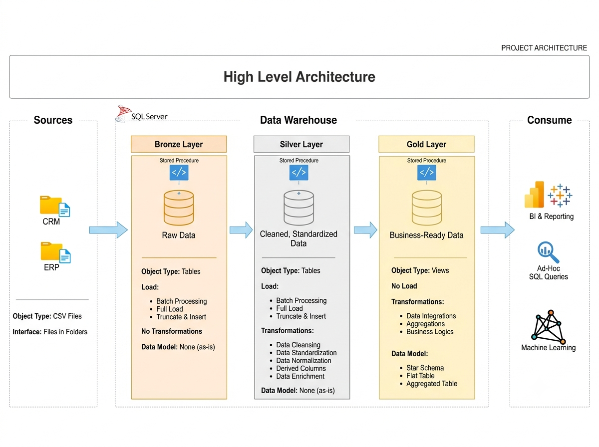

# 📊 SQL Data Warehouse & Analytics Project

Building an end-to-end Data Warehouse using SQL Server, including Data Architecture, ETL pipelines, Data Modeling, and Analytics.

---

## 🏗️ Data Architecture
The data architecture for this project follows the **Medallion Architecture** comprising **Bronze**, **Silver**, and **Gold** layers:



1. **Bronze Layer**: Ingests raw data as-is from source systems (CSV files) into the SQL Server database.
2. **Silver Layer**: Performs data cleansing, standardization, and normalization to prepare the dataset for analysis.
3. **Gold Layer**: Houses business-ready data modeled into a star schema optimized for reporting and analytics.

---

## 📁 Repository Structure

```text
├── datasets/               Source data files
│   ├── source_crm/         Extracts from the CRM system
│   └── source_erp/         Extracts from the ERP system
├── docs/                   Requirements, architectural diagrams, and technical specifications
├── scripts/                Database and ETL scripts
│   ├── init_database.sql   Database initialization script
│   ├── bronze/             Raw data ingestion scripts
│   ├── silver/             Data cleaning and transformation scripts
│   └── gold/               Star schema and analytical data model scripts
└── tests/                  Data quality and validation checks for Silver and Gold layers
```
---
## 📖 Project Overview

Key objectives implemented in this repository:
1. **Architecture Design:** Established a 3-tier Medallion Data Warehouse (Bronze, Silver, Gold).
2. **ETL Pipelines:** Built data ingestion and transformation procedures using SQL Server.
3. **Data Modeling:** Transformed cleaned data into fact and dimension tables using a Star Schema structure.
4. **Business Analytics:** Created analytical SQL queries to derive actionable business insights.

---

## 🛠️ Tools & Technologies Used
- **SQL Server & SSMS:** Core relational database management system for ETL processing and warehousing.
- **Git & GitHub:** Version control and source code management.
- **draw.io:** Data architecture and schema diagramming.

---

## 🚀 Project Requirements

### Data Engineering (Data Warehouse & Pipeline)
* **Data Sources:** Ingest sales data from two source systems (ERP and CRM).
* **Data Quality:** Cleanse, handle nulls/duplicates, and resolve anomalies before gold-layer modeling.
* **Integration:** Combine CRM and ERP sources into a unified analytical data model.
* **Scope:** Processes and maintains the latest snapshot dataset.
* **Documentation:** Clear specifications for schemas, ETL pipelines, and business logic.

### Data Analysis & Business Intelligence
* **Customer Behavior:** Analyze purchasing patterns, customer metrics, and segmentation.
* **Product Performance:** Track sales across product lines, categories, and items.
* **Sales Trends:** Evaluate revenue, period-over-period growth, and key performance indicators.

For detailed specifications, see `docs/requirements.md`.

---

## 🛡️ License
Distributed under the [MIT License](LICENSE).
